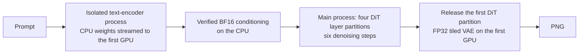

# MiniMax H3-Image on AMD ROCm

Run **MiniMax-H3-Image at its original BF16/FP32 precision on four AMD Radeon AI PRO R9700 GPUs**. This project provides an independent image inference backend built on pinned ComfyUI modules, with explicit CPU offload, multi-GPU layer placement, and reproducible resource measurements.

**Native 4K · Official six-step schedule · No weight quantization · AMD RDNA4**

[Measured performance](#measured-performance) · [Quick start](#quick-start) · [How it works](#how-it-works) · [Documentation](docs/README.md) · [Development](CONTRIBUTING.md)

## What works today

- Original MiniMax-H3-Image weights: BF16 text encoder and DiT backbone, the released FP32 modules and PDD heads, and the original FP32 VAE.
- Four R9700 GPUs working on one image, with CPU offload for the text encoder and device reuse between stages.
- Six model evaluations, CFG=1, batch=1, and the released PDD sigma schedule.
- Per-stage latency, per-device VRAM, process-tree RAM, output hashes, and resource-ownership checks for every run.
- A pinned ROCm 10.1 environment with project-local application dependencies and build caches. vLLM-Omni is not a dependency.

## Measured performance

The resolution comparison uses **the same four R9700s, product-photography prompt, seed 42, original BF16/FP32 weights, six steps, and CFG=1**. Here, 1K, 2K, and 4K mean square images of 1024, 2048, and 4096 pixels per side.

<!-- resolution-benchmark:start -->
| Resolution | Full request (s) | Six-step denoise (s) | Peak VRAM / GPU (GiB) | Peak CPU RAM, RSS (GiB) | Host RAM growth (GiB) |
|---|---:|---:|---:|---:|---:|
| 1K · 1024 × 1024 | **68.61** | 7.30 | 16.38 | 6.56 | 6.43 |
| 2K · 2048 × 2048 | **80.58** | 15.23 | 16.76 | 6.47 | 5.96 |
| 4K · 4096 × 4096 | **144.12** | 67.34 | 18.34 | 6.65 | 6.04 |

Measured on **November 13, 2026**, with **two completed fresh-process requests per resolution**. Times are arithmetic means; memory figures are the highest observed values across the two requests. All three pairs produced byte-identical conditioning, initial noise, six step latents, and PNGs.

[Detailed benchmark report](docs/benchmarks/R9700_NATIVE_RESOLUTIONS.md) · [Machine-readable results and source hashes](docs/benchmarks/r9700-native-resolutions.json)
<!-- resolution-benchmark:end -->

**How to read the numbers.** Full-request time includes isolated text encoding, weight loading, all six denoising steps, VAE loading/decoding, PNG saving, and in-process cleanup. It excludes process/container bootstrap and foundation validation. Each sample starts a fresh process; filesystem and kernel caches may already be warm. These are instrumented single-request measurements, not persistent-server throughput.

VRAM is the highest whole-card usage observed on any of the four selected devices, sampled every 0.5 seconds. CPU RAM is the summed process-tree RSS peak; it can count shared pages more than once. Whole-host RAM growth also includes page-cache and unrelated host activity. Sampling can miss shorter transients, and observed RAM is not a minimum system-RAM requirement.

The existing Attention policy forces PyTorch Flash for sequences of at least 4096 tokens. The 2K and 4K DiT requests meet that threshold; the shorter 1K request uses the ordinary PyTorch SDPA dispatcher. No weight precision, step count, or offload policy changes between resolutions.

## Quick start

The current launcher targets the **existing R9700 workspace foundation**: Linux, Docker, the parent workspace's `rocm10-launch.sh`, its locked image, and its shared GPU reservation/lock directories. See [environment setup](docs/QUICKSTART.md) before using these commands on a new checkout.

| Component | Tested version |
|---|---|
| GPUs | 4 × AMD Radeon AI PRO R9700, RDNA4 / `gfx1201` |
| ROCm | `10.1.0` |
| PyTorch | `2.14.0+rocm10.1.0` |
| Triton | `3.8.0+git669b31ac.rocm10.1.0` |
| Python | `3.13.13` |
| ComfyUI | `v0.45.0`, commit `989d93d0d968e704c589ce0146bb18c77f6b50cc` |

Keep the exact Torch/Triton pairing from the [environment lock](configs/runtime-lock.json). Application packages and rebuilt native extensions live in this project's `.runtime/`.

Download the pinned original components into `models/`:

```bash
python3 tools/download_native_models.py --workers 8 --chunk-mib 64
```

The selected download is 122.33 GB across 40 files, including all DiT shards, PDD heads, VAE, tokenizer, and the text-encoder shards needed for Image's layer-50 hidden state. [Model sources and checksums](models/README.md) identify both fixed revisions. Weights are kept outside Git.

Generate a 4K image from the project root:

```bash
python3 tools/run_rocm10.py \
  --gpus 1,5,6,7 \
  --run-dir runs/native-4k-seed42 \
  --timeout 1800 \
  --monitor-interval 0.5 \
  -- .runtime/venv/bin/python tools/run_native_image.py \
  --mode four-static \
  --config configs/native_t2i.json \
  --width 4096 --height 4096 --seed 42
```

Use `--width 1024 --height 1024` for 1K or `--width 2048 --height 2048` for 2K, with a new `--run-dir` each time. Add `--prompt "..."` to supply your own prompt. The configuration retains six steps and CFG=1.

`--gpus` takes **ordered physical GPU IDs**, which the launcher maps to logical devices. Select four currently available cards; physical GPU3 is excluded on this host. The launcher checks occupancy and reservations, holds shared locks, and stops its own job if another process starts using a selected device.

After the request finishes, produce the compact resource report:

```bash
python3 tools/summarize_native_run.py runs/native-4k-seed42
```

The run directory contains the generated PNG, `result.json`, `summary.json` / `summary.md`, per-stage timings, 0.5-second resource samples, and conditioning/noise/step-latent artifacts. The [A/A example](docs/QUICKSTART.md) shows how to compare a second identical request.

## How it works



The DiT partitions hold blocks **0–10, 11–23, 24–36, and 37–49**. They remain on their assigned GPUs during denoising. A single image passes through these partitions sequentially; this is capacity-oriented layer placement, not tensor parallelism or four independent image replicas.

Text encoding runs in a disposable process and hands the main process a hash-verified BF16 conditioning artifact. This boundary is part of the validated numerical policy. Large DiT Attention calls fail explicitly when the required Flash backend is unavailable.

## Validation and scope

The original 4K qualification passed a **three-prompt × two-seed matrix** covering product photography, architecture, and illustration. A same-input, same-device-order A/A pair matched conditioning, initial noise, all six step latents, and the final PNG exactly. Source and model identities are recorded with each request.

The supported claim is **single-image text-to-image generation with CPU offload on this pinned R9700 environment**. Concurrent serving, throughput scaling, editing, prompt expansion, batch sizes above one, and an all-GPU-resident pipeline remain unqualified. Same-implementation reproducibility does not establish pixel equivalence with a different inference engine.

## Project map

| Path | Purpose |
|---|---|
| [`docs/`](docs/README.md) | Setup guide, benchmarks, source identities, and historical releases |
| [`tools/`](tools/README.md) | Setup, inference, and reporting tool reference |
| [`configs/`](configs/README.md) | Workloads, environment identities, and historical inputs |
| [`src/minimax_h3_image_rocm/`](src/minimax_h3_image_rocm/) | Original-precision Image pipeline, weights, encoder, DiT, VAE, and metrics |
| [`tools/run_rocm10.py`](tools/run_rocm10.py) | Foundation launcher, device reservations, ownership checks, and resource monitoring |
| [`tools/run_native_image.py`](tools/run_native_image.py) | Measured single-request inference entry point |
| [`tools/summarize_resolution_sweep.py`](tools/summarize_resolution_sweep.py) | CPU-only validation and export of matched resolution benchmarks |
| [`configs/native_t2i.json`](configs/native_t2i.json) | Frozen prompt, precision policy, and official six-step schedule |
| [`configs/o5_qualification_matrix.json`](configs/o5_qualification_matrix.json) | Three-prompt, two-seed functional qualification workload |
| [`models/README.md`](models/README.md) | Model links, fixed revisions, and checksums |
| [`docs/NATIVE_SOURCES.md`](docs/NATIVE_SOURCES.md) | Upstream commits, file hashes, and license identities |
| [`CONTRIBUTING.md`](CONTRIBUTING.md) | Development checks, numerical qualification, and publication boundaries |

The earlier **single-card INT8 ConvRot 2K** baseline is preserved in [`v0.1.0-image-int8-first-image`](docs/releases/v0.1.0-image-int8-first-image.md). It uses different weights and precision and is not part of the native-precision table above.

## Sources and repository boundaries

Model weights come from [MiniMaxAI/MiniMax-H3-Image](https://huggingface.co/MiniMaxAI/MiniMax-H3-Image) and the [MiniMax-H3 text encoder](https://huggingface.co/MiniMaxAI/MiniMax-H3/tree/0919fb684102ef115126612f3fbb84d1027e7317/text_encoder). The backend uses pinned [ComfyUI](https://github.com/Comfy-Org/ComfyUI) modules and audits numerical conventions against the recorded Diffusers source. Models and third-party code retain their respective licenses; consult [source and license details](docs/NATIVE_SOURCES.md).

The repository contains source, configurations, and deliberately prepared documentation and benchmark summaries. **Weights, environments, raw images/tensors/traces, `runs/`, `vibe/`, and `research/` stay local.** Only `models/README.md` is tracked under `models/`.
